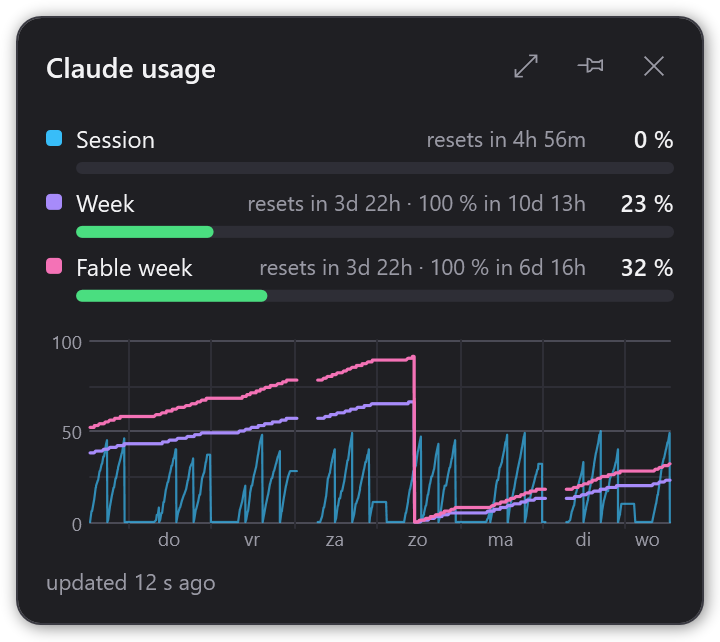

# Claude Usage

A small Windows tray widget that shows your Claude plan usage (session, week, and the per-model week) as reported by Claude Code's `/usage` command. The tray icon shows the highest percentage, coloured green / amber / red (under 70 / under 90 / 90 and over).



- Borderless, draggable window; closing it hides it to the tray.
- Optional "stay on top"; window position and that setting are remembered.
- Tray menu: current stats, Show UI, Refresh now, Open data folder, Start with Windows, Quit.

## Requirements

- Windows 10/11
- [.NET 10 runtime](https://dotnet.microsoft.com/download/dotnet/10.0) (desktop)
- [Claude Code](https://claude.com/claude-code) installed and logged in with a subscription (Pro/Max)

## How it gets data

Once a minute the app runs `claude -p "/usage" --output-format json --no-session-persistence`. This is a local command: it does not call the model and uses no tokens. The output text is parsed into the three usage buckets; if the format changes, the window shows the raw text.

> **Do not test `/usage` from Git Bash.** MSYS rewrites `/usage` into a path, which turns it into a real, billed prompt. Use PowerShell or cmd.

## Where data lives

`%LOCALAPPDATA%\ClaudeUsage\`

| File | Contents |
|---|---|
| `history.jsonl` | one sample per poll, used for the 7-day chart |
| `settings.json` | stay-on-top, window position, optional `claude` path override |
| `log.txt` | errors and unparsable output |

## Build, run, test, publish

```powershell
dotnet build ClaudeUsage.sln
dotnet run --project src/ClaudeUsage
dotnet test
dotnet publish src/ClaudeUsage -p:PublishProfile=win-x64   # -> publish/ClaudeUsage.exe (framework-dependent, single file)
```

A running instance locks its `.exe`; stop it before building.

Debug switch: `ClaudeUsage.exe --snapshot out.png` renders the window with synthetic data to a PNG and exits.
